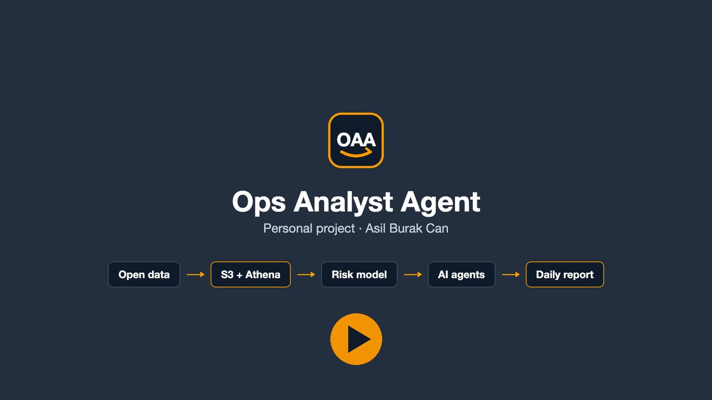
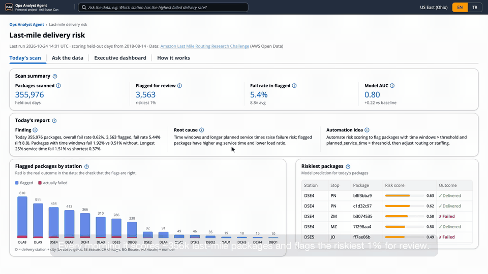
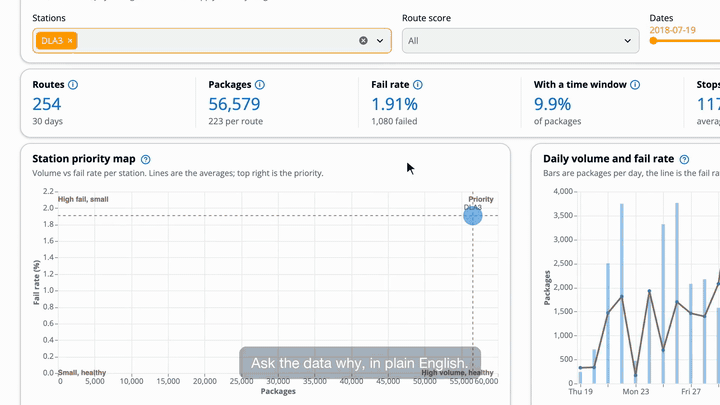
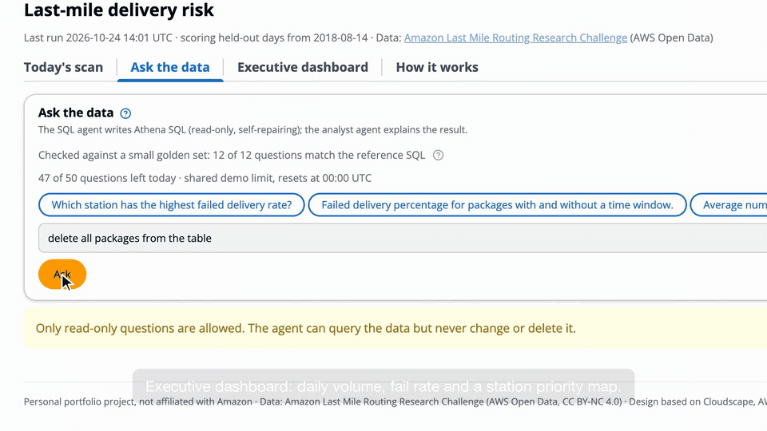
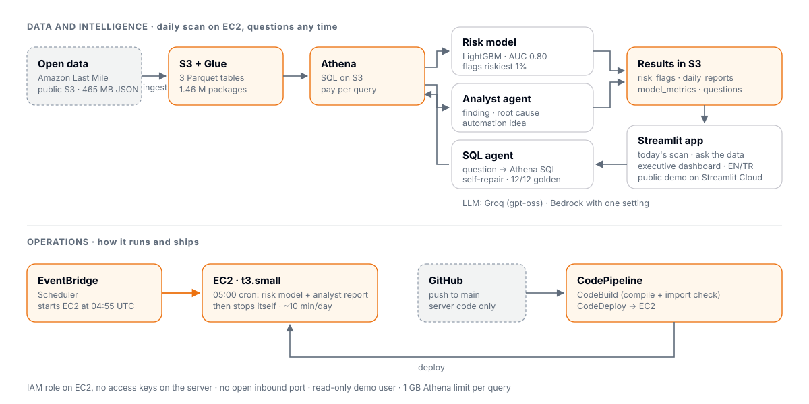
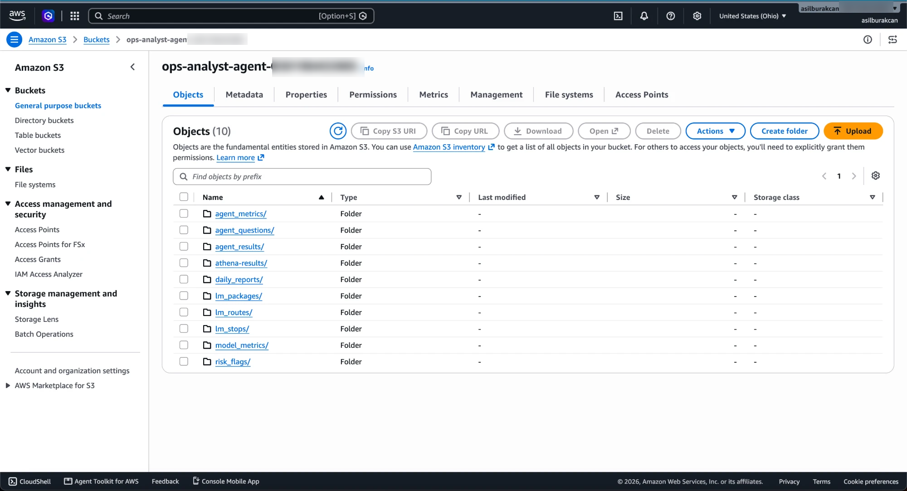
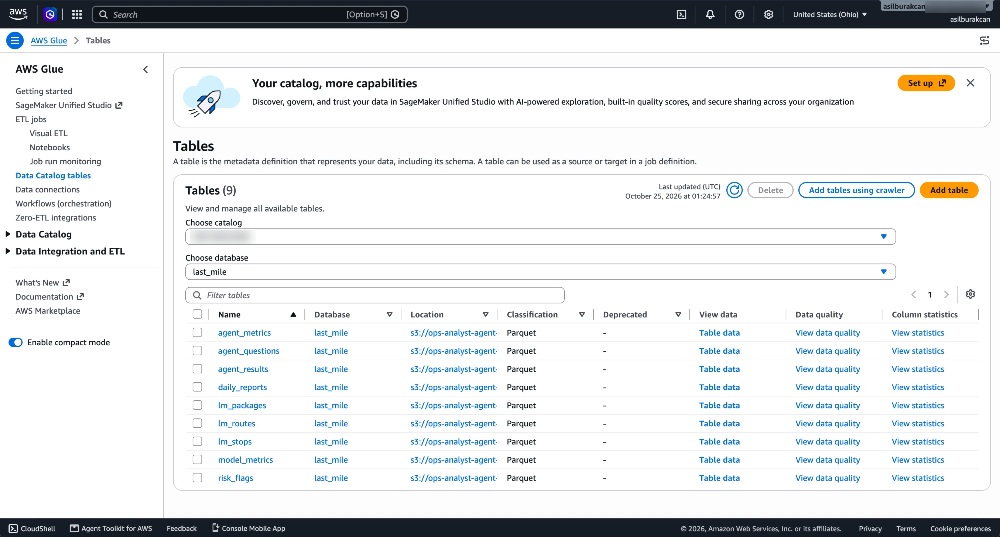
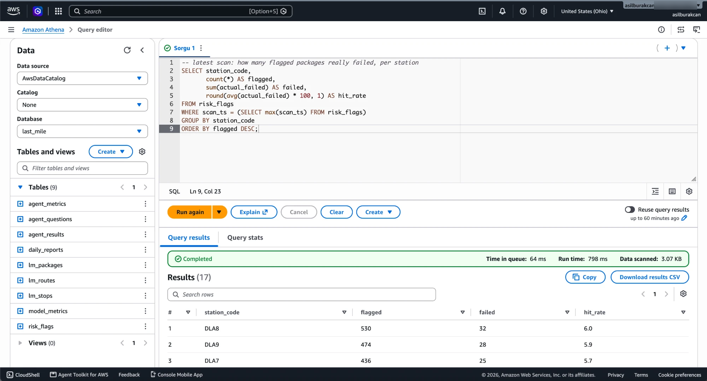
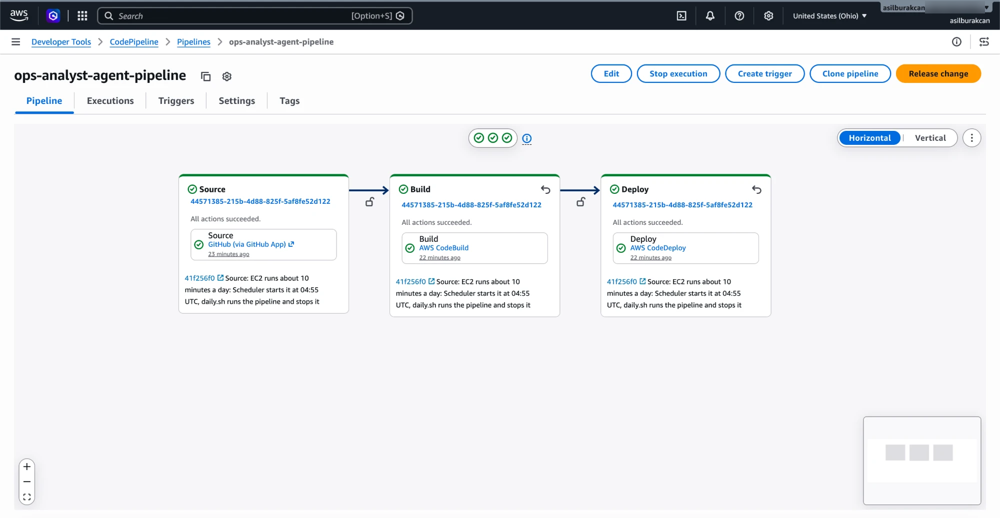
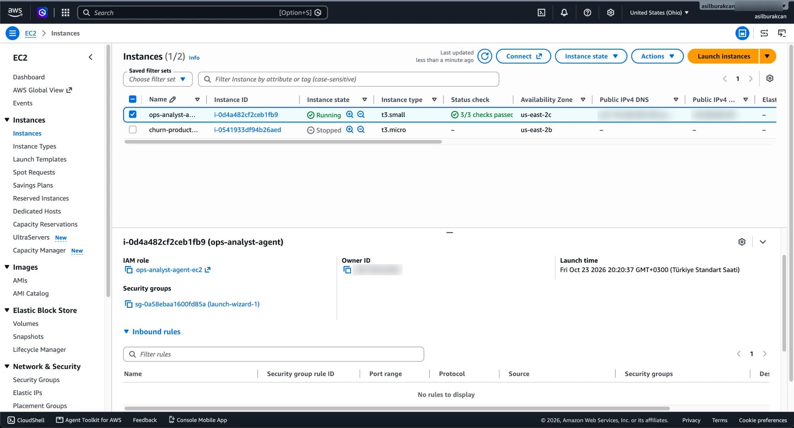

# Ops Analyst Agent (OAA)

An AWS system that finds last-mile packages likely to fail at the door, writes a daily operations report and answers operations questions in plain language.

**[Live demo](https://ops-analyst-agent.streamlit.app)** · **[Video, 95 s](https://asilburakcan.github.io/Ops-Analyst-Agent/video/oaa_demo_en.mp4)** · **[Case study (PDF)](https://asilburakcan.github.io/Ops-Analyst-Agent/OAA_case_study.pdf)** · **[Project page](https://asilburakcan.github.io/Ops-Analyst-Agent/)**

*Click to watch the narrated demo (95 s, English).*

## What it does

- **Risk model (LightGBM):** every morning it scores the day's packages before the vans leave and flags the riskiest 1% for review.
- **Analyst agent:** writes the daily report: a finding, a root cause backed by comparison tables, and an automation idea.
- **SQL agent:** turns a question into Athena SQL, runs it and repairs its own failed queries. It can only read.
- **Operator app:** today's scan, a question box and an executive dashboard, in English and Turkish.

## Tour

**Today's scan:** the morning's KPIs, the analyst's report and the flags checked against what really happened.

**Ask the data:** a question in plain English, the SQL the agent wrote, the result and the analyst's notes.

**Executive dashboard:** network KPIs, a station priority map and the daily trend. The whole app also works in Turkish.

## Results

Tested on 13 days the model never saw (356k packages, 2018-08-14 → 08-26):

| | Result |
|---|---|
| Model AUC | **0.80** (station fail rate rule: 0.59, time window rule: 0.58) |
| Fail rate in the flagged 1% | **5.4%**, about **9×** the 0.62% average |
| SQL agent golden set | **12 / 12** questions match the reference SQL |

Accuracy is not used: with 0.62% failures, "everything gets delivered" already scores 99.38%.
The strongest signals are planned service time at the stop, packages per stop, station, time to the delivery window and route size. Packages with a delivery window fail about 4× more often (2.38% vs 0.62%).

## Architecture

- **Data:** `ingest.py` reads the public Amazon Last Mile files, checks them and writes three Parquet tables to S3, registered in Glue. Athena queries them.
- **Daily run:** EventBridge Scheduler starts the EC2 instance at 04:55 UTC. At 05:00 cron runs `scripts/daily.sh`: the model, the analyst report and the results to S3. Then the instance stops itself, so it runs about 10 minutes a day.
- **CI/CD:** a push that changes server code runs CodePipeline: CodeBuild compiles and imports every module, CodeDeploy installs it on EC2. App and documentation changes skip the pipeline.
- **Demo:** the app runs on Streamlit Community Cloud with a read-only IAM user. Athena stops any query above 1 GB, and the question box allows 50 questions a day.
- **LLM:** Groq (`gpt-oss-120b` for SQL, `gpt-oss-20b` for the analyst). `LLM=bedrock` runs the same agents on Amazon Bedrock with no other change.

## Running on AWS

AWS console: S3, Glue, Athena, CodePipeline, EC2

## Data

[2021 Amazon Last Mile Routing Research Challenge](https://registry.opendata.aws/amazon-last-mile-challenges/) dataset: 6,112 real routes from 17 stations in 5 US metro areas, driven in July–August 2018. Licensed [CC BY-NC 4.0](https://creativecommons.org/licenses/by-nc/4.0/) by Amazon; the data is not in this repo.

| Table | Rows | One row is |
|---|---|---|
| `lm_routes` | 6,112 | a route |
| `lm_stops` | 904,527 | a stop on a route |
| `lm_packages` | 1,457,175 | a package at a stop |

Every ingest stops on a package without a stop, a stop without a visit order or a duplicate row. Two real data facts are kept and reported: 6,515 dropoffs have no `zone_id`, and 1,422 packages appear at two or more stops of one route. Terms and columns: [DATA_DICTIONARY.md](DATA_DICTIONARY.md). The agents read its glossary, so they and this document use the same terms.

The dataset is historical, so each daily run scores the same held-out days. Only the ingest source would change for live data.

## Files

| File | Job |
|---|---|
| `backend.py` | The only file that talks to AWS: Athena queries, S3 + Glue writes, LLM calls |
| `ingest.py` | Public S3 → three checked Parquet tables in own S3 + Glue |
| `model.py` | Risk model, time-split test, daily risk flags and comparison tables |
| `agents.py` | SQL agent (self-repair, read-only guard) and analyst agent |
| `eval.py` | Golden-set check of the SQL agent |
| `pipeline.py` | The daily entry point: model, report, optional golden set |
| `app.py` | Streamlit app: today's scan, ask the data, executive dashboard |
| `buildspec.yml`, `appspec.yml`, `scripts/` | Build check, deploy to EC2, daily job that stops the instance |

## Run it yourself

1. `pip install -r requirements.txt`, then copy `.env.example` to `.env` and set the bucket, region and Groq key.
2. `python pipeline.py --eval` ingests the data, trains and scores, writes the report and runs the golden set.
3. `streamlit run app.py` opens the app. One question from the terminal: `python agents.py "Which station has the highest failed delivery rate?"`

On AWS: an EC2 instance role with S3, Athena, Glue and Systems Manager access; CodeDeploy + CodePipeline from this repo; an EventBridge schedule that calls `StartInstances` at 04:55 UTC.

**Cost:** a few cents a month. EC2 runs about 10 minutes a day, Athena charges $5 per TB scanned and the data is 124 MB.

**Safety:** no access keys on the server (IAM role), no open inbound port, single `SELECT` statements only, write requests refused before any query.

## License

Code: MIT. Data: Amazon, CC BY-NC 4.0. Personal portfolio project, not affiliated with Amazon.
